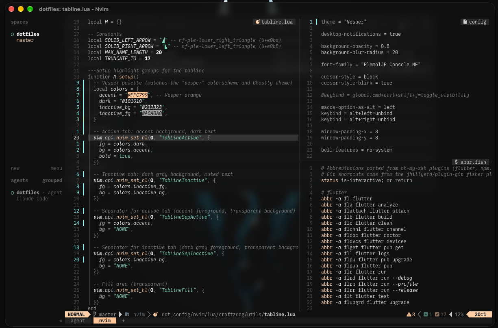

# Kautsar's dotfiles

Forked from [craftzdog/dotfiles](https://github.com/craftzdog/dotfiles) by Takuya Matsuyama, with my own tweaks on top.

**Warning**: Don’t blindly use these settings unless you know what that entails. Use at your own risk!

## Changes from upstream

- **Vesper theme everywhere**: Ghostty (`Vesper`, background blur kept), Neovim ([vesper.nvim](https://github.com/datsfilipe/vesper.nvim), transparent), and herdr (`vesper`). The custom Neovim tabline uses the Vesper palette instead of Solarized Osaka.
- **oh-my-zsh style shortcuts in fish**:
  - [plugin-git](https://github.com/jhillyerd/plugin-git) for the oh-my-zsh git aliases (`gst`, `gco`, `gcm`, …)
  - `conf.d/abbr.fish`: abbreviations ported from the oh-my-zsh flutter, npm, opencode and vscode plugins (`flr`, `flget`, `npmrd`, `opc`, `vsc`, …)
- **Neovim tweaks**:
  - `;f` uses the snacks `smart` picker with frecency (buffers, recent and project files, like VS Code's Cmd+P); `;F` is the plain file finder
  - Up/Down select items in the cmdline completion menu; Option+Left/Right move by word in insert mode
  - [flutter-tools.nvim](https://github.com/nvim-flutter/flutter-tools.nvim) with keymaps under `<leader>F` (`Fd` device, `Fr` run, `Fl` reload, `FR` restart, `Fq` quit, `Fg` log, `Fo` outline, `Ft` DevTools)
- **Flutter via [fvm](https://fvm.app)**: `fvm` and `cocoapods` in the Brewfile; fish wraps `flutter` and `dart` to run through `fvm`, and flutter-tools.nvim uses the project's `.fvm/flutter_sdk`.
- **Node via mise**: `node = "lts"` in the mise config.
- **Machine-specific settings** (paths, SDKs, API keys) live in `~/.config/fish/config-local.fish`, which chezmoi ignores, so they never enter this repo.

## Install

```sh
brew install chezmoi
chezmoi init --apply kxgcayh
```

`chezmoi init` asks for your name, email and GitHub username to fill in the git config. Applying also installs the `Brewfile`, global npm packages and fisher plugins.

On macOS it also asks whether to install the Windows cross-compile tools (`mingw-w64`, `xmake`, `xwin` from `Brewfile.windows-cross`). The answer is saved; run `chezmoi init --prompt` to change it.

On macOS, setup also sets Fish as your default login shell. It may ask for your
Mac login password to register Fish in `/etc/shells` and change the shell. This
step runs once per machine and skips the change if Fish is already the default.
Log out and back in afterward, or run `exec fish` in your current terminal.

To pull in upstream changes:

```sh
git remote add upstream https://github.com/craftzdog/dotfiles.git  # once
git fetch upstream && git merge upstream/master
```

## Contents

Managed with [chezmoi](https://www.chezmoi.io/).

- Neovim config
- [herdr](https://herdr.dev/) config (terminal workspace manager for AI agents)
- tmux config
- Ghostty config
- git, lazygit and gh config
- Zed and opencode config
- fish config
- PowerShell config
- Homebrew, apt, Scoop and winget package lists

## Neovim setup

### Requirements

- Neovim >= **0.12** (plugins are managed with the built-in `vim.pack`)
- Git
- [lazygit](https://github.com/jesseduffield/lazygit) **_(optional)_**
- [tree-sitter CLI](https://github.com/tree-sitter/tree-sitter) and a **C** compiler for `nvim-treesitter`
- for the [snacks.nvim](https://github.com/folke/snacks.nvim) picker:
  - **live grep**: [ripgrep](https://github.com/BurntSushi/ripgrep)
  - **find files**: [fd](https://github.com/sharkdp/fd)
- a terminal that supports true color and _undercurl_, such as [Ghostty](https://ghostty.org/)
- [vesper.nvim](https://github.com/datsfilipe/vesper.nvim)
- Flutter SDK (installed with `fvm`) for flutter-tools.nvim **_(optional)_**

## Terminal setup

- [Ghostty](https://ghostty.org/) - Terminal emulator
- [herdr](https://herdr.dev/) - Workspace manager for running AI coding agents side by side, with tmux-style keybindings (prefix `ctrl+t`)
- [tmux](https://github.com/tmux/tmux) - Terminal multiplexer

### Fonts

Installed as Homebrew casks from the `Brewfile`:

- [Meslo Nerd Font for Powerlevel10k](https://github.com/romkatv/powerlevel10k-media) (`MesloLGS NF`) - Ghostty's font
- [BlexMono Nerd Font](https://github.com/ryanoasis/nerd-fonts)

## Shell setup (macOS & Linux)

- [Fish shell](https://fishshell.com/)
- [Fisher](https://github.com/jorgebucaran/fisher) - Plugin manager
- [Tide](https://github.com/IlanCosman/tide) - Shell theme
- [z for fish](https://github.com/jethrokuan/z) - Directory jumping
- [Eza](https://github.com/eza-community/eza) - `ls` replacement
- [ghq](https://github.com/x-motemen/ghq) - Local Git repository organizer
- [fzf](https://github.com/PatrickF1/fzf.fish) - Interactive filtering
- [plugin-git](https://github.com/jhillyerd/plugin-git) - oh-my-zsh style git aliases

## PowerShell setup (Windows)

- [Scoop](https://scoop.sh/) - A command-line installer
- [Git for Windows](https://gitforwindows.org/)
- [Oh My Posh](https://ohmyposh.dev/) - Prompt theme engine
- [Terminal Icons](https://github.com/devblackops/Terminal-Icons) - Folder and file icons
- [PSReadLine](https://docs.microsoft.com/en-us/powershell/module/psreadline/) - Cmdlets for customizing the editing environment, used for autocompletion
- [z](https://www.powershellgallery.com/packages/z) - Directory jumper
- [PSFzf](https://github.com/kelleyma49/PSFzf) - Fuzzy finder

## How to use

Takuya's video tutorials explain the original setup:

1. [My Neovim setup](https://www.youtube.com/watch?v=fFHlfbKVi30)
   - [Article version](https://www.devas.life/effective-neovim-setup-for-web-development-towards-2024/)
1. [My dev workflow using tmux and vim](https://www.youtube.com/watch?v=sSOfr2MtRU8&list=PLxQA0uNgQDCICMRwlOzWAZBPL05XBC_br&index=10)
1. [A productive command-line Git workflow for indie app developers](https://www.youtube.com/watch?v=qKpY7t5m35k&list=PLxQA0uNgQDCICMRwlOzWAZBPL05XBC_br&index=4)
   - [Blogpost](https://dev.to/craftzdog/a-productive-command-line-git-workflow-for-indie-app-developers-k7d)
1. [My Fish shell workflow for coding](https://www.youtube.com/watch?v=KKxhf50FIPI)
1. [How to set up PowerShell prompt with Oh My Posh on Windows 11](https://www.youtube.com/watch?v=5-aK2_WwrmM)

## Credits

Original dotfiles by Takuya Matsuyama ([craftzdog](https://github.com/craftzdog)):

- [@inkdrop_app on X](https://twitter.com/inkdrop_app)
- [Newsletters](https://www.devas.life/)
- [Inkdrop - Markdown note-taking app](https://www.inkdrop.app/)

## Zsh restore and local settings

The Zsh backup includes Powerlevel10k settings. Install Oh My Zsh and the
Powerlevel10k theme separately, plus the plugins listed in `.zshrc`:
`zsh-autosuggestions`, `zsh-syntax-highlighting`, and `zsh-interactive-cd`.
Built-in plugins come with Oh My Zsh. NVM, jenv, Android SDK, and FVM need their
usual setup before their shell integration is useful.

Before restoring `.zshrc`, move credentials, custom volume paths, compiler
flags, Windows cross-compilation variables, AI command wrappers, and other
machine overrides from your current shell file into unmanaged `~/.zshrc.local`.
The managed shell sources this file first, before the instant prompt and plugin
initialization. Keep local secrets out of Git. `PUB_CACHE` and `EXT_DRIVE` belong
there if used; portable home paths use `$HOME` in the backup. Review `chezmoi diff`
before applying, and keep a private copy of your old shell settings.

The Brewfile preserves existing entries and adds installed tools and fonts.

## Devault sync (macOS)

`~/.local/bin/devault-sync` exports ai-memory session notes and rebuilds vault
indexes. The LaunchAgent runs every five minutes and at login. The installation
hook reloads the agent when its script or plist changes. Restoring these files
with chezmoi will activate that agent; inspect the proposed changes first.
Python 3 and an existing Obsidian vault are required. No vault content is backed
up here.

Keep the vault location in unmanaged `~/.config/devault/config.json` using the
`vault` field; optionally set `ai_memory` there for a custom ai-memory data root.
Alternatively the script recognizes `DEVAULT_VAULT` and `AI_MEMORY_DATA_DIR`, or
finds a vault named Devault in Obsidian's local settings. launchd does not inherit
interactive shell settings, so prefer the JSON configuration for the agent.
Use `devault-sync --where` to inspect the chosen vault and `--dry-run` to preview
writes. Logs and state live in `~/.local/state/devault-sync/`.

## Backup checks

Install `pre-commit` and Gitleaks separately, then run `pre-commit install` in
this repository. The configured hook scans for secrets and literal personal
home or volume paths in changed configuration. CI runs the same path check and
Gitleaks. Local overrides and AI configuration should stay outside the backup.
